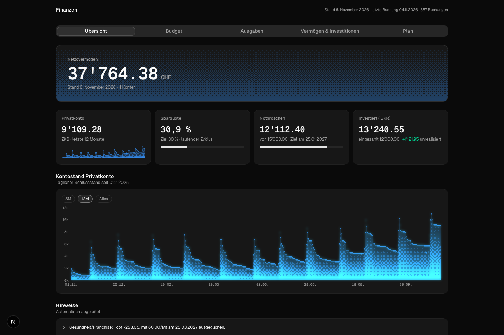
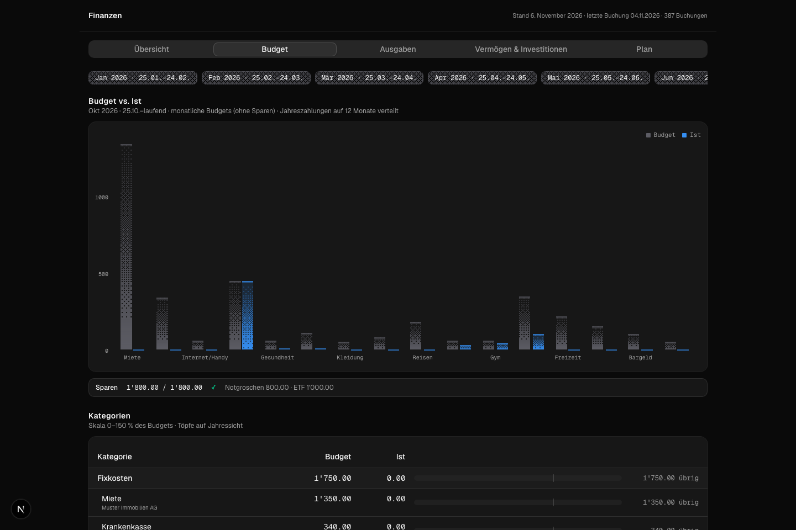
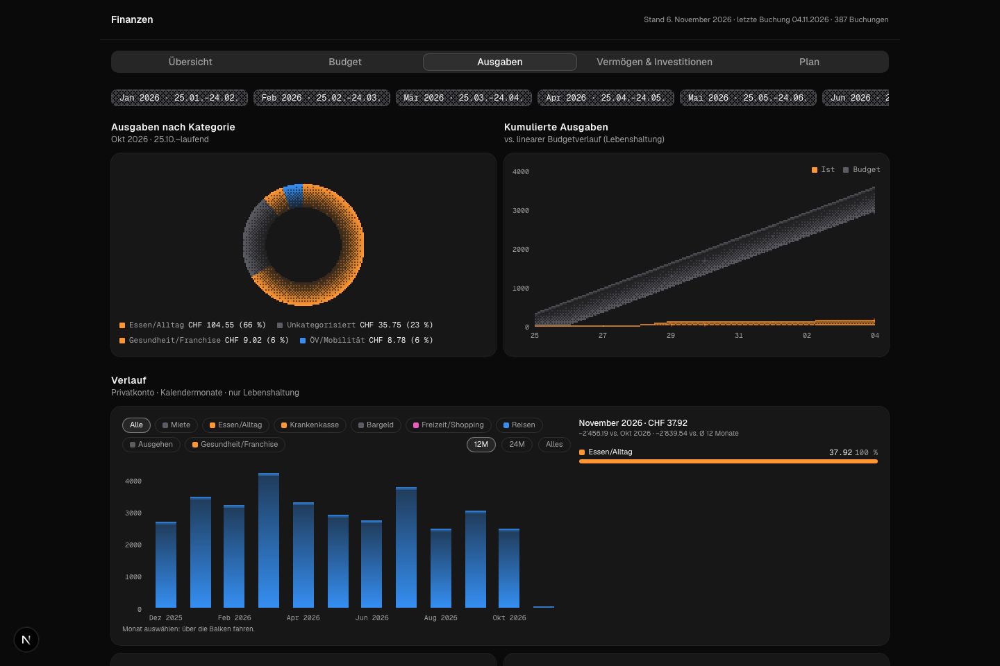
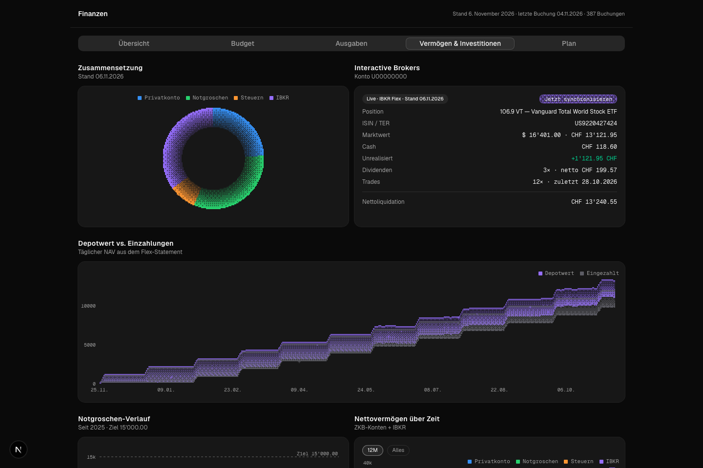
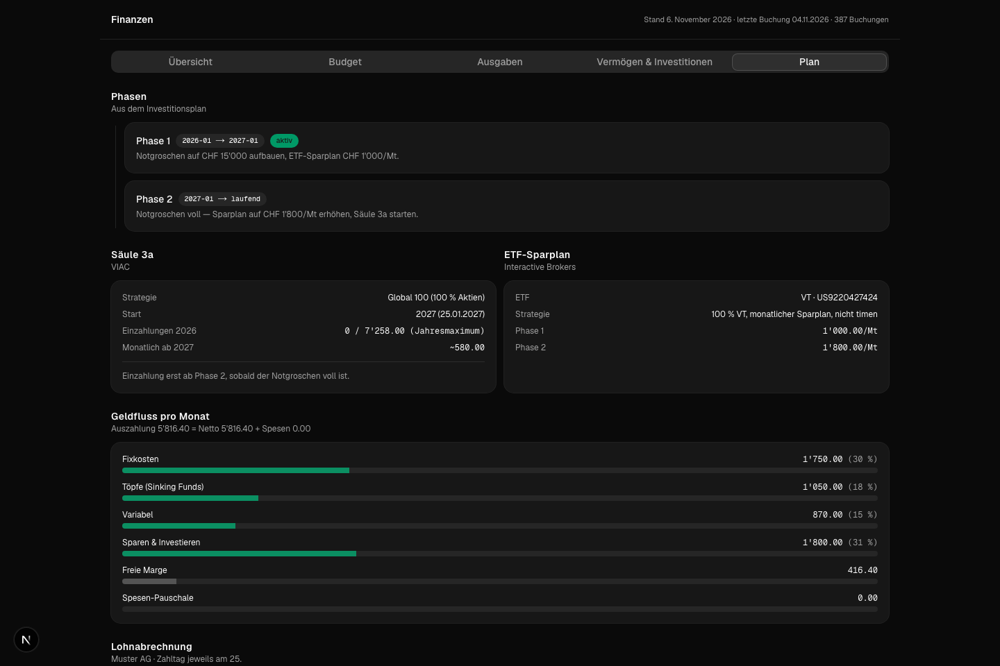

# Finance Dashboard

A self-hosted personal finance dashboard for a Swiss bank account (ZKB) plus an
Interactive Brokers portfolio. Single-user, file-based, no database: all data
lives in a local directory of JSON/CSV files. The UI is in German, all amounts
in CHF.

Built with Next.js and Bun. Created in [T3 Code](https://t3.codes).

## Features

- **Übersicht** (overview): net worth, account cards, daily balance history,
  savings rate, emergency-fund progress, auto-derived insights.
- **Budget**: pay-cycle budgeting (a cycle runs from one salary payment to the
  next, not calendar months), budget vs. actual per category, sinking funds
  ("Töpfe") with yearly targets and recovery dates, annual payments spread over
  their covered months.
- **Ausgaben** (spending): spending by category, cumulative spend vs. linear
  budget, monthly history, top payees, full searchable transaction table with a
  category editor that can also create categorisation rules.
- **Vermögen & Investitionen**: net worth over time across all accounts, IBKR
  position/NAV vs. cumulative deposits, dividends and trades, emergency fund and
  ETF projection charts.
- **Plan**: investment plan phases, pillar 3a, monthly money flow, payslip
  breakdown.
- **Import**: drop a ZKB camt.053 XML or CSV export onto the Ausgaben tab (or
  use `bun run import`); bookings are deduplicated, assigned to accounts via
  IBAN, and categorised by first-match-wins rules from `rules.json`.
- **IBKR sync**: pulls the daily NAV, positions, deposits, dividends and trades
  via the Flex Web Service (see `lib/ibkr/SETUP.de.md`, in German). Without it,
  a manual snapshot in `finance.json` is shown instead.

## Screenshots

| | |
| --- | --- |
|  |  |
|  |  |
|  | |

All screenshots show the committed fictional demo data.

## Tech stack

- Next.js 16 (App Router, Turbopack), React 19, TypeScript
- Tailwind CSS v4, custom canvas "dither-kit" chart components
- Bun for scripts and tests; fast-xml-parser for camt.053
- No database, no ORM: `finance.json` + `transactions.csv` + `rules.json` +
  optional `ibkr.json` per data directory

## Quick start (demo data)

```bash
bun install
bun run demo     # next dev with FINANCE_DATA_DIR=data/demo
```

Open http://localhost:3000. The app runs entirely on `data/demo/`, a fictional
dataset ("Alex Muster", fake IBANs, IBKR account U00000000) generated by
`scripts/generate-demo.ts`. On a fresh clone, plain `bun run dev` also falls
back to the demo data when `data/private/` does not exist.

Regenerate the demo files deterministically with `bun run demo:generate`.
Screenshots: start the demo server, then `bunx playwright install chromium`
once and `bun scripts/screenshot-demo.ts`.

## Using your own data

Create `data/private/` (gitignored) with the same four files:

```
data/private/
  finance.json       accounts, anchors, budget, goals, plan, income
  transactions.csv   date,valuta,account,payee,text,amount,category
  rules.json         categorisation rules, first match wins
  ibkr.json          optional, written by the IBKR Flex sync
```

Key conventions:

- `finance.json.balancesAsOf` is the anchor date; each account's `balance` is
  its true balance on that date. History is derived from the CSV, so old rows
  may be incomplete.
- `budgetStart`: salary ("Lohn") bookings before this date never create a
  budget cycle.
- Account ids used by the app: `privat`, `notgroschen`, `steuern`, `ibkr`
  (ZKB accounts need `institution: "ZKB"` for the net worth chart).
- `FINANCE_DATA_DIR` points the app and the importers at any data directory.

Import bank exports:

```bash
bun run import <camt.xml|zkb.csv> [--dry-run] [--account <id>]
```

camt.053 files are matched to accounts by statement IBAN; ZKB CSV exports have
no IBAN and need `--account`. New rows are appended to `transactions.csv`;
anything no rule matches lands in `Unkategorisiert` and can be recategorised
in the UI (which can also prepend a rule to `rules.json`).

IBKR sync: `bun run ibkr-sync` reads token and query id from the macOS Keychain
and writes `ibkr.json`. Setup walkthrough (German): `lib/ibkr/SETUP.de.md`.

## Project structure

```
app/                 Next.js routes (page + /api/import, /api/ibkr/sync, /api/transactions/category)
components/finance/  the five tab views
components/dither-kit/  custom canvas chart kit
lib/finance/         types, loader, analysis, pay-cycle logic
lib/import/          camt.053 + ZKB CSV parsers, dedupe, rules engine, importFiles
lib/ibkr/            Flex Web Service client, snapshot merge, Keychain, SETUP.de.md
scripts/             import.ts, ibkr-sync.ts, generate-demo.ts, screenshot-demo.ts
data/demo/           fictional demo dataset (committed)
data/test-fixtures/  small fictional snapshot the tests assert against (committed)
data/private/        your real data (gitignored)
```

## Testing

```bash
bun test           # unit + route tests (run against data/test-fixtures)
bun run build      # next build
bun run lint       # eslint
```

`lib/finance/live-data.test.ts` additionally sanity-checks a local
`data/private/` when present and skips silently otherwise.

## Privacy

Personal data lives only in `data/private/`, which is gitignored, and in the
macOS Keychain (IBKR credentials). The repo and the demo run on fictional data
generated by `scripts/generate-demo.ts`; no real names, IBANs, amounts or
positions appear anywhere in committed files.
